# Deploy to a server

A step-by-step guide to running Clinical Care Navigator on a Linux server behind
HTTPS. It uses the repository's `compose.prod.yaml`, which builds the API and the
web app and publishes **no host ports**: a reverse proxy is the only way in.

<!-- Source: docs/diagrams/deploy-topology.mmd. Regenerate with `make docs-diagrams`. -->


The browser talks to one origin. The proxy sends `/api/*` to the API (removing the
`/api` prefix, because the API itself has no such prefix) and everything else to
the web app.

!!! info "How this was checked"
    Both images were built from the repository's Dockerfiles, started with
    `compose.prod.yaml` behind a Caddy container, and exercised in a browser:
    the site and `/api/healthz` through the proxy, a full live run with its steps
    streaming in as they happened, a reload replaying that run, no host ports
    reachable, and the basic-auth rules below. That ran on a local machine with
    plain HTTP, so **automatic HTTPS certificates, DNS and a public firewall were
    not exercised**; those parts rely on Caddy's documented behaviour.

## 1. What you need

- A Linux server with a public IP, reachable by SSH.
- A domain name with an `A` record pointing at the server (for example
  `clinical.example.com`).
- [Docker Engine](https://docs.docker.com/engine/install/) with the Compose plugin
  (`docker compose version` should work).
- An OpenAI API key.
- Ports **80 and 443** open to the internet, and nothing else except SSH.

## 2. Get the code onto the server

```bash
git clone https://github.com/zarreh/clinical_care_navigator.git
cd clinical_care_navigator
```

The continuous-deployment workflow publishes the API image to GitHub Container
Registry but not the web image, and its server-deploy job is still a placeholder.
So this guide builds both images on the server.

## 3. Put the data on the server

The API reads three read-only databases from `data/` (`records.db`,
`education.db`, `policy.db`) and writes two of its own there at runtime
(`runs.db` and `checkpoints.db`). `data/` is git-ignored and excluded from the
image, so you have to provide it. Pick one option.

=== "Build it on the server"

    Needs [`uv`](https://docs.astral.sh/uv/) and outbound internet access (it
    downloads the public Synthea sample data and education pages).

    ```bash
    uv sync --extra dev
    make data
    ```

=== "Build it locally and copy it"

    On the machine where you already ran `make data`, copy **only** the three
    read-only databases:

    ```bash
    rsync -av \
      --include='records.db' --include='education.db' --include='policy.db' \
      --exclude='*' \
      data/ you@your-server:~/clinical_care_navigator/data/
    ```

    Do not copy `runs.db` or `checkpoints.db`: they are the other machine's run
    history and paused reviews.

The API container runs as user **1000**, so that user must be able to write to
`data/`:

```bash
sudo chown -R 1000:1000 data
```

Without this the API exits at startup with
`sqlite3.OperationalError: unable to open database file` and
`Application startup failed`.

## 4. Configure

Create `.env` in the repository root. It is read by `docker compose` for the API
container, and the two `WEB_PUBLIC_*` lines are also used as **build arguments**
for the web image.

```ini
# --- API (runtime) ---
NAVIGATOR_OPENAI_API_KEY=sk-...
NAVIGATOR_ENVIRONMENT=production
NAVIGATOR_FRONTEND_ORIGINS='["https://clinical.example.com"]'

# --- Web (baked into the JavaScript at build time) ---
WEB_PUBLIC_API_URL=https://clinical.example.com/api
WEB_PUBLIC_DOCS_URL=https://zarreh.ai/clinical_care_navigator/
```

| Variable | Why it matters |
|---|---|
| `NAVIGATOR_OPENAI_API_KEY` | Without it, runs that need the model fail. |
| `NAVIGATOR_ENVIRONMENT` | Anything other than `development` switches logs to JSON. |
| `NAVIGATOR_FRONTEND_ORIGINS` | CORS allow-list as a JSON list. Outside `development` this is the only thing trusted (localhost is not). Because the proxy serves the site and the API from one origin the browser does not need CORS, but set it to your public origin anyway. |
| `WEB_PUBLIC_API_URL` | Where the browser calls the API. Must be the **public** URL ending in `/api`. The default, `http://localhost/api`, only works on the server itself. |
| `WEB_PUBLIC_DOCS_URL` | Target of every "Learn more" and Docs link. Point it at wherever you host the documentation site. |

Optional: `NAVIGATOR_LANGSMITH_API_KEY` for tracing, `NAVIGATOR_AUTONOMY_LEVEL`,
and the rate limits (see [Run it yourself](run-it-yourself.md#configuration-worth-knowing-about)).

!!! warning "The two `WEB_PUBLIC_*` values are build-time"
    Next.js inlines them into the bundle. Changing them in `.env` does nothing
    until you rebuild the web image (`docker compose -f compose.prod.yaml up -d --build`).
    A site whose API calls go to `localhost` was built without
    `WEB_PUBLIC_API_URL`.

!!! note "Keep `.env` out of git"
    It holds your API key. It is already git-ignored and excluded from the
    images.

## 5. Set up the reverse proxy

`compose.prod.yaml` attaches both services to an **external** Docker network
named `edge`. Create it once, then run a proxy on it. These services are named
`navigator-api` and `navigator-web` so they don't clash with other apps sharing
the network.

```bash
docker network create edge     # skip if it already exists
```

Create a directory for the proxy, for example `~/proxy`, with two files.

`~/proxy/compose.yaml`:

```yaml
services:
  caddy:
    image: caddy:2
    restart: unless-stopped
    ports:
      - "80:80"
      - "443:443"
    volumes:
      - ./Caddyfile:/etc/caddy/Caddyfile:ro
      - caddy_data:/data        # certificates live here
      - caddy_config:/config
    networks:
      - edge

volumes:
  caddy_data:
  caddy_config:

networks:
  edge:
    external: true
```

`~/proxy/Caddyfile`:

```caddyfile
clinical.example.com {
	handle_path /api/* {
		reverse_proxy navigator-api:8000 {
			flush_interval -1
		}
	}

	handle {
		encode zstd gzip
		reverse_proxy navigator-web:3000
	}
}
```

Two details matter here:

- `handle_path` strips `/api` before forwarding. Without it the API sees
  `/api/conversations` and returns 404.
- `flush_interval -1` sends the live run stream through immediately instead of
  buffering it, and `encode` is deliberately kept off the `/api` routes so the
  stream is never compressed into a lump.

Caddy also requests and renews the HTTPS certificate for the domain by itself.

Start it:

```bash
cd ~/proxy && docker compose up -d
```

??? note "Using nginx instead (not tested here)"
    The same four requirements apply: strip `/api`, do not buffer the stream,
    and **set** the client address rather than appending to what the client sent.

    ```nginx
    location /api/ {
        proxy_pass http://navigator-api:8000/;      # trailing slash strips /api
        proxy_http_version 1.1;
        proxy_set_header X-Forwarded-For $remote_addr;
        proxy_set_header Host $host;
        proxy_buffering off;                        # server-sent events
        proxy_read_timeout 120s;
    }
    location / {
        proxy_pass http://navigator-web:3000;
        proxy_set_header X-Forwarded-For $remote_addr;
        proxy_set_header Host $host;
    }
    ```

## 6. Start the app

From the repository root:

```bash
docker compose -f compose.prod.yaml up -d --build
```

The first build takes a few minutes. The web container waits for the API's
health check to pass before it starts.

Check it:

```bash
docker compose -f compose.prod.yaml ps          # both should say "healthy"
curl https://clinical.example.com/api/healthz   # {"status":"ok"}
docker compose -f compose.prod.yaml exec navigator-api printenv NAVIGATOR_FRONTEND_ORIGINS
```

Then open `https://clinical.example.com/`, run one of the example questions, and
confirm the steps appear one by one and a result card shows up. A live run takes
roughly 15–40 seconds.

To demonstrate the clinician review queue, which is normally empty, load three
sample drafts (scripted, no model call):

```bash
docker compose -f compose.prod.yaml exec navigator-api python -m navigator.api.demo_seed
```

## 7. Protect the clinician review queue

!!! danger "Do this before the site is public"
    The app has no login. Anyone who can reach `/reviews` can approve, edit or
    decline a held answer. Putting basic auth at the proxy covers both the page
    and the API calls the page makes.

Generate a password hash, then add a `basic_auth` block to the site in your
Caddyfile (above `handle_path`):

```bash
docker compose -f ~/proxy/compose.yaml exec caddy caddy hash-password
```

```caddyfile
clinical.example.com {
	@reviews path /reviews /reviews/* /api/reviews /api/reviews/*
	basic_auth @reviews {
		clinician <paste-the-hash-here>
	}

	handle_path /api/* {
		# ...unchanged...
	}
	handle {
		# ...unchanged...
	}
}
```

```bash
docker compose -f ~/proxy/compose.yaml exec caddy caddy reload --config /etc/caddy/Caddyfile
```

With this in place the home page and `/api/healthz` stay public, while
`/reviews` and every `/api/reviews…` request (including the decision `POST`)
return `401` without credentials. The visitor-facing questions are unaffected.
Do not try to protect the API with a key in browser code: anything in the
browser is visible to everyone.

## 8. Operate it

**Logs**

```bash
docker compose -f compose.prod.yaml logs -f navigator-api
```

**Update to a new version**

```bash
git pull
docker compose -f compose.prod.yaml up -d --build
```

`data/` is untouched. Any run in flight during the restart cannot finish; on
startup the API marks it **failed** ("interrupted by a server restart") and puts a
review that was mid-decision back in the queue, so nothing spins forever.

**Back up**

`runs.db` (conversation history and the review queue) and `checkpoints.db` (the
paused state a held review resumes from) belong together: a review points into the
checkpoint database. Back them up as a pair. The other three databases are
rebuildable with `make data`.

```bash
mkdir -p backups
sqlite3 data/runs.db        ".backup 'backups/runs-$(date +%F).db'"
sqlite3 data/checkpoints.db ".backup 'backups/checkpoints-$(date +%F).db'"
```

**Reset the history**

Stop the stack, then delete `runs.db`, `checkpoints.db`, `checkpoints.db-wal` and
`checkpoints.db-shm` **together**. Deleting only one leaves held reviews that can
no longer be resumed.

**Run one API process.** Runs execute inside the API process and the stores are
SQLite files, so do not scale `navigator-api` to several replicas or workers.

## 9. Troubleshooting

| Symptom | Likely cause and fix |
|---|---|
| API container exits with `unable to open database file` | `data/` is not writable by user 1000. Run `sudo chown -R 1000:1000 data`. |
| The page loads but every question fails, or the browser tries `localhost` | `WEB_PUBLIC_API_URL` was missing or wrong when the web image was built. Fix `.env` and rebuild with `up -d --build`. |
| `404` on every API call through the proxy | The proxy is not stripping `/api`. Use `handle_path` (Caddy) or a trailing slash on `proxy_pass` (nginx). |
| The run seems to hang, then everything appears at once | The proxy is buffering the event stream. Use `flush_interval -1` (Caddy) or `proxy_buffering off` (nginx), and do not compress `/api`. |
| The page says "the API did not answer" while the API is up | The browser blocked the call because the page's origin is not in `NAVIGATOR_FRONTEND_ORIGINS`. Add the exact public origin (scheme and host, no path) and restart the API. |
| Everyone gets `429 Too many requests` | The rate limit is per client address. If the proxy does not pass the real client address, all visitors share one bucket. Make the proxy **set** `X-Forwarded-For` (Caddy does by default). Also see the limits in [Run it yourself](run-it-yourself.md#configuration-worth-knowing-about). |
| Runs fail with an authentication error from the model | `NAVIGATOR_OPENAI_API_KEY` is missing or wrong in `.env`. Recreate the container after fixing it: `docker compose -f compose.prod.yaml up -d`. |
| "Docs" links go to the wrong place | Set `WEB_PUBLIC_DOCS_URL` and rebuild the web image. The documentation site itself is published to GitHub Pages by the CD workflow; use whatever URL it ends up at. |

## 10. Security notes

- The API trusts `X-Forwarded-For` from any peer (`--forwarded-allow-ips "*"`) so
  the per-client rate limit sees real visitors. That is safe **only** because no
  host port is published and the proxy replaces the header; both were checked: a
  spoofed `X-Forwarded-For` sent through Caddy arrives replaced by the real
  address. Never publish the API port directly.
- Open only 22, 80 and 443 in the server firewall.
- The patient is a choice among demonstration personas, not a login: the API only
  answers as those personas (`NAVIGATOR_DEMO_PATIENTS_ONLY`, on by default), but it
  cannot tell who is asking. See [Choose who you are asking as](run-it-yourself.md#choose-who-you-are-asking-as).
- The data is entirely synthetic, and the app states it is not a medical device.
  Do not point it at real patient records: there is no setting for that and no
  login, audit trail or access control that real data would require.
